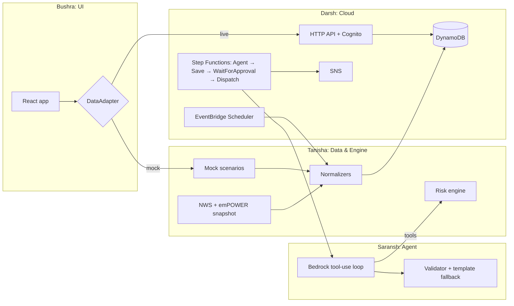

# GridRisk – Implementation Plan

## Problem

Emergency Operations Center (EOC) staff see power outages, flooded roads and 911 calls as separate
feeds. GridRisk links them into one risk, e.g. _"Zone A is cut off, has no power, and 340
electricity-dependent patients live there – 45 minutes left."_ It then proposes actions, and **a human must approve** before anything is dispatched.

The scripted 60-second, 3-act demo is **out of scope for now**. The hooks for it are
`POST /simulate/{scenario}` and `POST /simulate/reset`, plus `MockAdapter.simulate/reset`.

## Requirements

- **Frontend:** React + Vite + TypeScript, Tailwind (dark only: bg `#0f172a`, text `#f8fafc`,
  critical `#ef4444` with pulse, `font-mono` for IDs/coords/timers), maplibre-gl + react-map-gl,
  framer-motion, lucide-react, Zustand.
- **Data:** mostly mocked. Real: HHS emPOWER (patient counts by ZIP) and NWS alerts for
  Harris County. Basemap: Amazon Location _Monochrome_ dark style when `VITE_LOCATION_API_KEY` is
  set, otherwise a bundled offline dark style.
- **Assumption:** "average backup 2 hours" is **not in any dataset**. It is a configurable
  assumption (`avgBackupMinutes = 120`).
  `isolationWindowMinutes = avgBackupMinutes − estimatedResponseMinutes (75) = 45`.
- **Agent:** Amazon Bedrock (Claude) Converse API with tool use. It **proposes only**. All numbers come
  from the deterministic engine, a validator rejects any number the model makes up, and a template fallback is used on any failure.
- **Backend:** CDK (TS), DynamoDB, HTTP API + Cognito JWT authorizer, Step Functions with
  `.waitForTaskToken` for human approval, SNS, EventBridge Scheduler ingest, Amplify Hosting.

## Team

| Person   | Track          | Owns                            | TODO                                                       |
| -------- | -------------- | ------------------------------- | ---------------------------------------------------------- |
| Saransh  | Agent          | `packages/agent`                | [todo/saransh-agent.md](todo/saransh-agent.md)             |
| Bushra   | UI             | `apps/web`                      | [todo/bushra-ui.md](todo/bushra-ui.md)                     |
| Tanisha  | Data & engine  | `packages/engine`               | [todo/tanisha-data-engine.md](todo/tanisha-data-engine.md) |
| Darsh    | Cloud & integ. | `infra`, `.github`              | [todo/darsh-cloud.md](todo/darsh-cloud.md)                 |
| Everyone | Contracts      | `packages/shared` (2 approvals) | [docs/CONTRACTS.md](docs/CONTRACTS.md)                     |

## Data sources (research summary)

| Demo element                   | Source                                             | Access                                | Use                                       |
| ------------------------------ | -------------------------------------------------- | ------------------------------------- | ----------------------------------------- |
| Electricity-dependent patients | HHS emPOWER REST (ArcGIS FeatureServer)            | Public, ZIP level, updated monthly    | **Real** (snapshot) → `dependentPatients` |
| Weather alerts                 | NWS `api.weather.gov/alerts/active?zone=TXC201`    | Public, GeoJSON, needs `User-Agent`   | **Real** → `DemoEvent` type `weather`     |
| River / gauge levels           | USGS Water Data API                                | Public                                | Optional proxy for "bridge flooded"       |
| Power outages                  | DOE ODIN (county level public); EAGLE-I (historic) | Public, county granularity            | Mocked polygon; ODIN optional             |
| CenterPoint (Houston utility)  | Outage tracker web map                             | **No official API**                   | Not used                                  |
| Road closures / high water     | DriveTexas API (TxDOT)                             | **Key required** (EM orgs, justified) | Mocked                                    |
| 911 calls                      | Houston Active Incidents page                      | **HTML only**, no API                 | Mocked                                    |
| Shelters                       | FEMA Open Shelters FeatureServer                   | Public, often empty outside disasters | Mocked (`Shelter B`)                      |
| Battery backup duration        | —                                                  | Not published anywhere                | **Assumption** in `engine/src/config.ts`  |

## AWS services

| Need                       | Service                                                    |
| -------------------------- | ---------------------------------------------------------- |
| Dark basemap               | Amazon Location Maps – Monochrome style, dark color scheme |
| Zone isolation (stretch)   | Amazon Location Routes with avoid-areas                    |
| Polling feeds              | EventBridge Scheduler → Lambda                             |
| Event / alert storage      | DynamoDB (`events` with stream, `alerts`)                  |
| Read / approve API         | API Gateway HTTP API + Cognito JWT authorizer              |
| Alert wording              | Amazon Bedrock (Claude) Converse + tool use                |
| Human-in-the-loop dispatch | Step Functions `.waitForTaskToken`                         |
| Notification               | Amazon SNS (email or verified SMS numbers – SMS sandbox)   |
| Hosting                    | Amplify Hosting (or S3 + CloudFront)                       |

## Architecture

## Tasks

| #   | Task                                                                     | Owner                | Milestone |
| --- | ------------------------------------------------------------------------ | -------------------- | --------- |
| 1   | Monorepo scaffold, shared contracts, stubs, CI                           | Bootstrap (**done**) | M0        |
| 2   | App shell, theme, Zustand store, MockAdapter, dev toolbar                | Bushra               | M1        |
| 3   | MapComponent (Amazon Location dark map style + offline fallback)         | Bushra               | M1        |
| 4   | EventFeed                                                                | Bushra               | M1        |
| 5   | AlertCard, countdown, approve states, connecting lines, dispatch visuals | Bushra               | M2        |
| 6   | Normalizers (NWS, emPOWER), snapshots, scenarios                         | Tanisha              | M1        |
| 7   | Deterministic risk engine (Turf.js)                                      | Tanisha              | M1        |
| 8   | Agent core: Bedrock Converse tool loop                                   | All (A1 T, A3 S)     | M1        |
| 9   | Grounding validator, template fallback, evals                            | All (A2 B, A4 D)     | M2        |
| 10  | Core infra: DynamoDB, HTTP API + Cognito, read/simulate Lambdas          | Darsh                | M1        |
| 11  | Step Functions human approval + SNS dispatch                             | Darsh                | M2        |
| 12  | Scheduled real-data ingest                                               | Tanisha + Darsh      | M2        |
| 13  | LiveAdapter + Cognito sign-in in web                                     | Bushra + Darsh       | M2/M3     |
| 14  | Real agent in RunAgent Lambda                                            | Saransh + Darsh      | M3        |
| 15  | Hosting, Playwright e2e, CI/CD                                           | Darsh                | M3        |
| 16  | Hardening: reset hook, offline check, runbook, 5× reliability run        | All                  | M3        |

**Sequencing.** Task 1 was done at bootstrap. The tracks then run in parallel:

- Bushra: 2 → 5
- Tanisha: 6 → 7 → 12
- Saransh: agent coordinator (A0 stubs, A3 loop); agent slices A1–A4 split across all four, see [todo/saransh-agent.md](todo/saransh-agent.md)
- Darsh: 10 → 11

Integration comes last: 13 → 14 → 15 → 16. Handoffs and stubs are listed in [docs/HANDOFFS.md](docs/HANDOFFS.md).

## Security notes

- Cognito JWT authorizer on **all** API routes. Without it, `approve` could be called by anyone with the URL.
- Amazon Location API key restricted to the app's referrer domains.
- SNS: email subscriptions or verified SMS numbers only (new accounts are in the SMS sandbox).
- No secrets in git: `.env` is gitignored, and runtime config lives in SSM Parameter Store.
- The agent cannot dispatch. Dispatch happens only after a human approves through the Step Functions task token.
- Bedrock IAM is scoped to the single chosen model.
